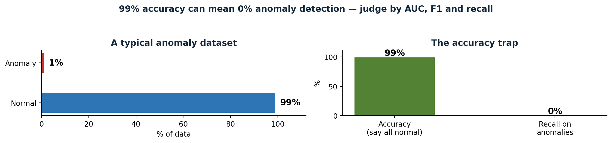
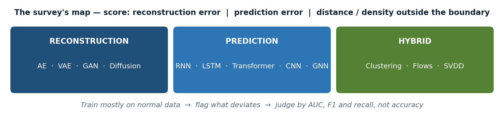
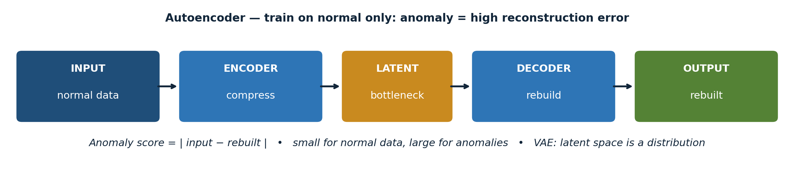
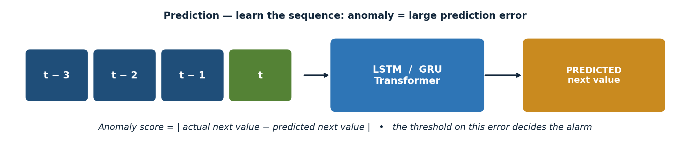
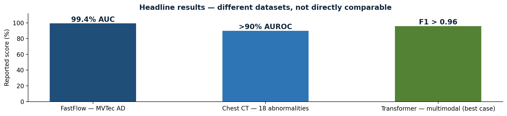
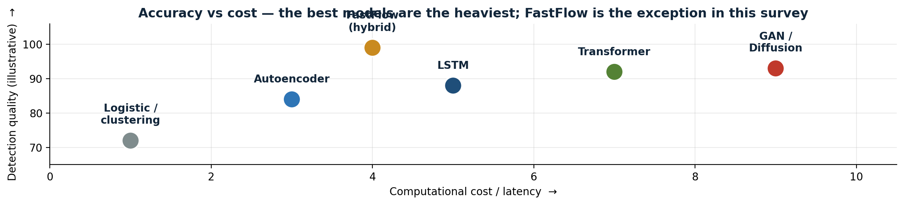

# Deep Learning Changed Anomaly Detection. The Hard Part Is Still the Data.

**Pranith Varma Pakalapati — San Jose State University, CMPE 255**

**Based on:** Haoqi Huang, Ping Wang, Jianhua Pei, Jiacheng Wang, Shahen Alexanian, and Dusit Niyato, "Deep Learning Advancements in Anomaly Detection: A Comprehensive Survey," arXiv:2503.13195v1, 17 March 2025, IEEE Internet of Things Journal.

---

An anomaly is a small thing with large consequences. One fraudulent transaction in a million legitimate ones. One sensor reading that quietly drifts away from normal in a factory, until a machine fails. One lesion on a scan that looks almost — but not quite — like healthy tissue. One cyberattack hidden in a log file full of ordinary traffic.

Anomaly detection is the work of finding those observations before they become a failure, a fraud, or a breach. That, more than any architecture, is what this survey is about.

The paper I chose for this short story is a survey, not a single new model. Huang and colleagues review over 180 recent studies, mostly from 2019 to 2024, drawn from IEEE, ACM, Springer and Elsevier journals and conferences such as AAAI, CCS and ICCV. What makes it worth reading is not a leaderboard. It is the organisation: a clear taxonomy, honest comparison tables, and a full section on what happens when you combine deep learning with the traditional methods it was supposed to replace.

This article is my reading of that survey — the gist, the architecture, the numbers, and my own two cents on what actually matters if you ever have to build one of these systems.

---

## What counts as an anomaly depends on the data

The survey starts where a good project should start — with the data, not the model. Text, audio, image, video and tabular data each produce different kinds of anomalies. In text, it might be an incoherent word sequence in a system log, or a word that is missing where it should be. In audio, a distortion, a frequency shift, or a missing segment. In an image, a spatial defect — a crack, a spot, a shape that does not belong. In video, an unusual movement, a scene change, or a motion inconsistency.

Then there is a second split, and it matters more: time-series versus non-temporal data. In a time series, order is information, so you get three kinds of anomalies. A point anomaly is one strange value — a single spike in a sensor reading. A sequence anomaly is a strange stretch — a week of readings that, taken together, do not look like any normal week. A group anomaly is a strange cluster — a set of observations that are unremarkable on their own but wrong together.

In non-temporal data, observations are treated as independent, and the question is simpler: does this point, or this group of points, belong?

This is the first practical lesson I took from the paper. Name your data type and your anomaly type before you choose a model. A model built for sequences will waste its main advantage on static data. A model built for static data will miss the one thing a time series gives you for free — what came before. I have seen student projects fail on exactly this: they pick a fashionable architecture first, then discover the data does not have the structure the architecture needs.

## The data is the hard part

The survey devotes a full section to data processing, and it reads like a list of reasons real projects fail. High dimensionality is first. As dimensions grow, distances lose meaning, and the model has to learn a useful lower-dimensional representation itself. A table with hundreds of columns is not just a bigger version of a table with ten columns — it is a different problem, and traditional distance-based methods break on it.

Class imbalance is second, and it is the trap that catches beginners. Anomalies are rare, so a model can report high accuracy simply by calling everything normal — while missing almost every anomaly. Imagine a dataset that is 99% normal and 1% anomalous. A model that predicts "normal" for every single row scores 99% accuracy and catches nothing. That is why the survey, and any honest evaluation, judges models by AUC, F1 score and recall on the anomaly class, not by accuracy.

Noise is third. Train an autoencoder on noisy data and it learns to reconstruct the noise. It overfits, and the real anomalies slip through. Missing and sparse values, common in sensor data, make all of this worse — and in the Internet of Things, sensors drop readings, go offline, and drift out of calibration.

The fixes the survey discusses are sensible and incomplete, and the authors say so. Oversampling the minority class, generating synthetic samples, and using conditional GANs to create extra anomalous examples can all help. But synthetic data may not capture how diverse real anomalies are, and augmentation can still leave a model biased toward normal data. There is no preprocessing step that removes the fundamental problem: you are trying to learn a class you have barely seen.

*Figure 1 — The accuracy trap. A model that calls everything normal scores 99% accuracy on a dataset that is 99% normal — and catches 0% of the anomalies. This is why the survey judges models by AUC, F1 and recall, not accuracy.*

## Where it actually gets used

The applications fall into three groups, and the range is the point. This is not a niche technique. It is the same idea, applied to very different data, in very different industries.

In time-series data: traffic monitoring, where loop sensors predict volume and flag unusual patterns; power systems, where the MENSA intrusion detection system detects operational anomalies and cyberattacks in smart grids; and healthcare, where heart rate and blood pressure are monitored continuously so that an abnormal change gets a fast response. In all three, the data arrives as a stream, and the value of the system is speed — an alert that comes an hour late is often no alert at all.

In non-temporal data: finance, where fraud detection examines individual transactions, credit scores and trading activity — bank fraud, insurance fraud, financial statement fraud and cryptocurrency fraud are each a different pattern, and the survey treats them separately; and cybersecurity, where intrusion detection flags unauthorised access and malicious behaviour in networks. Early work here used autoencoders, deep belief networks and RNNs; newer work adds far more sophisticated models, and the arms race with attackers never stops.

In visual data: medical imaging, where models flag abnormalities in X-rays, brain images and CT scans; video surveillance, where unusual behaviour in public spaces is detected; and manufacturing, where defects on a production line are caught without a human inspector at every station. The MVTec AD dataset, which appears again in the results section, is exactly this: industrial images with defects, used as a shared benchmark.

One result stayed with me. In chest CT volumes, a machine learning approach reported an AUROC above 0.90 for 18 different abnormalities. That is genuinely strong. But the survey adds the caveat that makes it believable: in medical images, anomalies often closely resemble normal tissue. The hard cases are not the obvious ones. They are the subtle ones, and that is true in every domain on this list — the fraud that looks like a normal purchase, the sensor reading that is only slightly off, the attack that mimics ordinary traffic.

## The map: reconstruction, prediction, hybrid

The core of the survey is its taxonomy, and it is simple enough to remember. Deep learning anomaly detection has three families, and everything else in the paper hangs off this map.

**Reconstruction-based methods** learn what normal looks like, rebuild the input, and flag anything with a large reconstruction error. The architectures here are autoencoders, variational autoencoders (VAEs), GANs and diffusion models.

**Prediction-based methods** learn the sequence, predict the next value, and flag anything where the prediction is badly wrong. Recurrent networks, LSTMs and GRUs, Transformers, convolutional networks and graph neural networks all live here.

**Hybrid methods** combine the two families, or combine deep learning with a traditional method — clustering, normalising flows, or support vector data description. This is Section V of the survey, and in my view it is the most interesting part, because it is where data mining meets deep learning instead of replacing it.

The map also tells you how to choose. Reconstruction asks: does it look normal? Prediction asks: does it follow? If your data has no time order, prediction has nothing to predict — use reconstruction. If your data is a sequence, prediction can use the one thing reconstruction ignores: what came before.

*Figure 2 — The survey's map. Reconstruction, prediction and hybrid — with the score each family uses to decide that something is anomalous.*

## Reconstruction: learn normal, rebuild, flag the error

An autoencoder is the simplest idea in the survey, and still one of the most useful. It compresses the input through a bottleneck and rebuilds it. It is trained only on normal data, so it learns to rebuild normal data well — and an anomaly, which it has never seen, rebuilds badly. The anomaly score is the reconstruction error: the difference between the input and the rebuilt output. Small for normal data, large for anomalies.

A variational autoencoder (VAE) makes the latent space probabilistic — a distribution with a mean and a variance, instead of a single point. That gives a more principled anomaly score, and it lets the model generate new samples. In practice, VAEs are better behaved than plain autoencoders on noisy, high-dimensional data, and they are the version I would reach for first.

GANs are more expressive and harder to tame. A generator creates realistic normal data; a discriminator judges real versus generated. Once trained, the generator's failure to reproduce an input, or the discriminator's judgement, can signal an anomaly. The survey's coverage here is what separates it from earlier surveys: it includes conditional GANs, cycle-consistent GANs, and GANs combined with VAEs or self-supervised learning — variants that older reviews missed. Diffusion models are the newest addition. They learn to denoise step by step, and an anomaly is a sample that does not denoise cleanly. They are powerful, and they are the most expensive to run.

The strength of this whole family is that it works unsupervised, on high-dimensional data, with no labelled anomalies at all — which is the common real-world case, since labelled anomalies are rare and expensive. The weaknesses are training cost and stability, especially for GANs, and a subtle failure mode that is easy to forget: reconstruction error alone can be fooled. An anomaly that happens to reconstruct well is missed entirely, and no amount of tuning the threshold will catch it, because the score itself is wrong.

*Figure 3 — The autoencoder pipeline. Input → encoder → bottleneck → decoder → rebuilt output. The anomaly score is the difference between the input and the rebuilt output.*

## Prediction: look at the past, predict the next value, measure the surprise

Prediction-based methods start from a different question. Instead of asking whether a sample looks normal, they ask whether it follows from what came before. Look at the past, predict the next value, and measure the surprise.

LSTMs and GRUs keep a hidden state that remembers what came before, with gates that control what to remember and what to forget. They remain the workhorse for time-series detection — well understood, well supported, and good enough for most problems. Transformers replace recurrence with attention, letting the model weigh different time steps directly instead of squeezing everything through a hidden state. The survey reports an F1 score above 0.96 in one multimodal setting, and up to a 17% F1 improvement from better inference in another study. Those are best-case numbers, from different datasets, and I will come back to that caveat — but the direction is real: attention helps where long-range dependencies matter.

Convolutional networks capture local patterns — a short sensor window, an image patch — and are often combined with recurrent layers, so the CNN handles local detail and the recurrent layer handles long-term context. Graph neural networks model relationships: sensors or entities as nodes in a graph, with edges for how they relate. A sensor that is fine on its own but suddenly disagrees with all its neighbours is a graph anomaly — a broken relationship, not just a strange value. That is a genuinely different kind of anomaly, and it is one that reconstruction alone cannot see.

The strength here is temporal and relational modelling. The weakness is that these models need sequential or relational data, they are heavier to run in real time, and — the point I keep coming back to — a good forecast is not the same as a good anomaly score. You still need a threshold on the prediction error, and the threshold is where many deployments quietly fail. A model that predicts well and thresholds badly is a bad anomaly detector.

*Figure 4 — The prediction pipeline. Past values feed an LSTM, GRU or Transformer, which predicts the next value. The anomaly score is the difference between the actual and predicted next value.*

## Hybrids: old ideas, new power

Three hybrid ideas stand out in the survey, and they share a pattern: deep learning supplies the features, and the traditional method supplies a boundary you can explain.

First, **clustering plus deep learning**. Extract features with a neural network, then cluster them. You keep the interpretability of clustering and gain the representation power of deep learning. One example in the survey clusters human pose graphs extracted from video to detect abnormal actions — a task where a pure deep model would give you a score and no explanation of what "normal" meant.

Second, **normalising flows**. These are sequences of invertible transformations that estimate the exact probability density of normal data, so an anomaly is simply a low-probability event. FastFlow, a normalising flow combined with ResNet and Vision Transformer features, reached 99.4% AUC on the MVTec AD industrial defect dataset, while maintaining high inference efficiency. That combination — best-in-survey accuracy and speed — is rare, and it is why FastFlow is the headline result of this article.

Third, **support vector data description (SVDD)**. Draw the smallest sphere that contains normal data in latent space, and flag anything outside it. Deep SVDD-VAE jointly optimises a VAE and an SVDD boundary, and it outperformed traditional autoencoder-based methods on MNIST, CIFAR-10 and GTSRB. The pattern is the same in all three cases, and it is the pattern I would bet on: features from deep learning, a boundary from a method you can describe in one sentence.

My take on this section is simple. Hybrids are not a compromise between two paradigms. They are the point. A score without a boundary you can describe is hard to trust, hard to debug, and hard to defend in a hospital, a bank, or a factory. When a doctor, a fraud analyst or a plant engineer asks "why did it flag this?", "because the reconstruction error was 0.83" is not an answer. "Because it falls outside the sphere that contains all our normal data" is the beginning of one.

## What actually works — and how to read the numbers

Here is where I want to be careful, because the survey's numbers come from different datasets, and they are not directly comparable. The pattern, though, is consistent — and the pattern is more useful than any single number.

On industrial images, FastFlow's 99.4% AUC on MVTec AD is the strongest single result in the survey, and it matters because it is both accurate and efficient. In medical imaging, an AUROC above 0.90 across 18 chest CT abnormalities shows these methods can work where the signal is subtle and close to normal tissue. In time-series and multimodal settings, Transformer-based models report F1 scores above 0.96 in the best cases. In the survey's comparison tables, reconstruction methods score well on high-dimensional unsupervised tasks, while prediction methods win where temporal dependencies are strong.

*Figure 5 — Headline results from the survey: FastFlow 99.4% AUC on MVTec AD, chest CT AUROC above 0.90 for 18 abnormalities, Transformer F1 above 0.96 in a multimodal setting. Different datasets — not directly comparable.*

The metric lesson is the one I would carry into any project: report AUC and F1, report recall on the anomaly class specifically, and never let a high overall accuracy hide a model that misses the rare events you actually care about. If a paper reports only accuracy on an imbalanced anomaly dataset, treat its headline with suspicion. And if a paper compares itself to a weak baseline, or on a private dataset nobody else can reproduce, treat it with more suspicion still. The survey's comparison tables are useful precisely because they make these differences visible — same methods, different datasets, different metrics, all in one place.

## Ablations and trade-offs: what I would actually test

The survey does not run a single big ablation study — it synthesises ablations from the papers it reviews. Reading across them, four conclusions stand out, and they are the most practical part of this article.

First, **the anomaly score matters more than the architecture**. Swapping an autoencoder for a VAE, or an LSTM for a Transformer, typically moves the score by a few points. Choosing the wrong score, or the wrong threshold, can break the system entirely. This is the finding I most wish someone had told me before my first anomaly detection project: I spent weeks on architecture, and the threshold was the thing that decided whether the system worked.

Second, **the training data matters more than the model**. Training only on clean normal data, handling imbalance properly, and removing noisy labels changes results more than adding another layer. This is unglamorous work, and it is where most of the performance lives. Data cleaning, labelling, and the definition of "normal" are not the boring preamble to the real work. They are the real work.

Third, **there is a real accuracy-versus-cost trade-off**. The best models are also the heaviest. For real-time use — fraud detection, autonomous driving, industrial monitoring — a lighter model that answers in milliseconds can be the right choice even if its AUC is a point lower. The survey is explicit that balancing real-time performance with accuracy remains challenging, and that lightweight models, GPU acceleration, and edge or cloud offloading are the current answers. FastFlow is interesting precisely because it breaks this trade-off: accurate and fast, where most models force you to choose.

Fourth, **engineered features still help, but only a little**. Domain features give small, honest gains, not breakthroughs. If a paper claims a large jump from feature engineering alone, check whether the baseline was weak.

*Figure 6 — Accuracy versus cost. The best models are usually the heaviest, which is why real-time systems often choose a lighter model. FastFlow is the exception the survey highlights.*

If I had to run one ablation first, it would be the threshold: fix the model, vary the threshold, and plot precision against recall. That one experiment tells you more about deployment than any architecture swap. It tells you what you lose when you catch more anomalies, and what you gain when you tolerate more false alarms — and that trade-off, not the architecture, is the decision your users will actually live with.

## Open issues: the honest ending

The survey closes with open issues, and they are refreshingly honest. Data collection is still the bottleneck — anomalies are rare, labelling them is expensive and needs experts, and synthetic data does not fully solve it. Computational complexity is second — autoencoders, GANs and LSTMs are expensive, and real-time detection needs lighter models. Explainability is third — deep models are black boxes, and in healthcare, finance and safety-critical systems, a score without a reason is not enough. The current answers are attention mechanisms and post-hoc tools like LIME and SHAP, and they are partial answers at best. Fourth, handling diverse anomaly types: a model that catches point anomalies may miss sequence or group anomalies entirely, and most papers only test one type.

The future directions the authors propose are self-supervised learning, more diverse synthetic data, adaptive frameworks, and real-time explainability. I would add one of my own: benchmarks. Until papers are compared on the same datasets, with the same splits and the same metrics, headline numbers will keep looking better than they are. A 99.4% AUC is meaningful because MVTec AD is a shared benchmark that everyone can reproduce. Too many results in this field are not.

## My two cents

If you read only one section of the survey, read Section V, the hybrids. If you build only one thing after reading it, build a reconstruction model with an explainable boundary — an autoencoder plus SVDD, or a normalising flow — on a dataset you understand, and spend most of your time on the threshold and the evaluation, not on the architecture.

Anomaly detection is the problem of finding the rare observations that matter most. Deep learning changed it by learning representations directly from high-dimensional, temporal, spatial and graph data, instead of relying on hand-crafted features. But the survey's real message is not a leaderboard. It is that data quality, class imbalance, thresholds and explainability decide whether a model works in the real world — and those are the parts no architecture, however new, can do for you.

The field's next step is not a bigger model. It is better data, shared benchmarks, and systems that can explain themselves. That is less exciting than a new architecture, and it is where the work actually is.

---

**About this article**

This article is my short story for CMPE 255 at San Jose State University, based on the survey by Huang et al. (arXiv:2503.13195v1, March 2025). The presentation slides, the 15–20 minute speaking script, and the full references are in the GitHub repository for this assignment. All figures in this article are the same diagrams used in the presentation.

**References**

- Huang, H., Wang, P., Pei, J., Wang, J., Alexanian, S., & Niyato, D. (2025). Deep Learning Advancements in Anomaly Detection: A Comprehensive Survey. arXiv:2503.13195v1. https://arxiv.org/abs/2503.13195
- Survey scope: 180+ studies, 2019–2024; IEEE Internet of Things Journal.
- Key results cited in this article are as reported in the survey: FastFlow 99.4% AUC on MVTec AD; chest CT AUROC > 0.90 for 18 abnormalities; Transformer F1 > 0.96 in a multimodal setting; up to 17% F1 improvement from better inference. These come from different datasets and are not directly comparable.
- All other papers mentioned (MENSA IDS, Deep SVDD-VAE, FastFlow, GAN variants) are as cited in the survey; see the survey's reference list for full citations.
